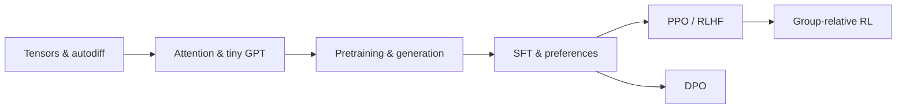

# LLM from First Principles

**Understand every tensor, operation, and gradient—from a tiny GPT to policy optimization.**


A hands-on learning path with explicit derivations, small experiments, and a reusable PyTorch package. Build the mechanisms yourself, inspect their behavior, then compose them into a working language-model pipeline.

**[Explore the lessons](#-learning-path)** · **[Run the demo](#-run-a-small-complete-example)** · **[Use the source package](src/README.md)** · **[PyTorch reference](TORCH_FUNCTIONS.md)**



## 🧭 Start where you need

| Your goal | Start here |
|---|---|
| Learn from the ground up | [Tensor basics](lessons/00_tensor_basics.ipynb), then follow the numbered notebooks. |
| Understand how a GPT fits together | [Transformer blocks and GPT](lessons/12_transformer_blocks_and_gpt.ipynb) → [pretraining](lessons/16_pretraining_a_tiny_gpt.ipynb). |
| Understand LLM post-training | [RL foundations](lessons/18_rl_foundations.ipynb) → [SFT](lessons/22_supervised_fine_tuning.ipynb) → [preferences](lessons/23_preference_data_and_reward_modeling.ipynb). |
| Reuse a mechanism in your own experiment | [Source guide and tensor contracts](src/README.md). |
| See the components run together first | [Checkpoint-free SFT/DPO example](examples/tiny_sft_dpo.py). |

This is an **educational implementation**, not a production training framework or a benchmark claim. Basic Python and familiarity with vectors, derivatives, and probability are helpful; the early notebooks develop the PyTorch foundations.

## 🚀 Run a small, complete example

With [uv](https://docs.astral.sh/uv/) installed:

```bash
git clone https://github.com/neuromaancer/llm-from-first-principles.git
cd llm-from-first-principles
uv sync
uv run python examples/tiny_sft_dpo.py
```

The example connects **character tokenization → a tiny GPT → completion-only supervised fitting → a frozen reference → DPO → greedy generation**. It runs on CPU by default, uses three built-in synthetic examples, and needs **no dataset download, API key, or existing checkpoint**.

```bash
# A smaller smoke run; do not expect useful generations after four updates.
uv run python examples/tiny_sft_dpo.py --sft-steps 4 --dpo-steps 2

# Optional, with a working CUDA-enabled PyTorch installation.
uv run python examples/tiny_sft_dpo.py --device cuda
```

It prints before/after losses, preference-margin changes, generated responses, and whether the reference remained unchanged. The GPT starts from random weights: this demonstrates **SFT-style composition**, not fine-tuning a pretrained assistant. Fitting these examples is not evidence of generalization.

See [the source walkthrough](src/README.md#end-to-end-example) for the actual modules, tensor shapes, and limitations. Python and dependency requirements are declared in [`pyproject.toml`](pyproject.toml); the repository environment is recorded in `uv.lock`.

## 📚 Learning path

Read in order for the complete derivation, or use the topic links below. There are 28 notebooks: lessons 00–26, with PPO split into 21A and 21B.

<details>
<summary><strong>01 · Language-model foundations — lessons 00–15</strong></summary>

| Notebook | What you will build or understand |
|---|---|
| [00 · Tensors](lessons/00_tensor_basics.ipynb) | Shapes, broadcasting, indexing, and reductions. |
| [01 · Autograd](lessons/01_autograd_from_scratch.ipynb) | Reverse-mode differentiation and gradient flow. |
| [02 · Tokenization](lessons/02_text_and_tokenization.ipynb) | Text representations, character tokens, and BPE concepts. |
| [03 · Batching](lessons/03_sequences_and_batching.ipynb) | Sequences, context windows, and next-token targets. |
| [04 · Embeddings](lessons/04_embeddings_and_linear_layers.ipynb) | Discrete IDs, learned representations, and linear layers. |
| [05 · Objectives](lessons/05_language_modeling_objectives.ipynb) | Softmax, likelihood, and cross-entropy. |
| [06 · Optimizers](lessons/06_optimizers_from_scratch.ipynb) | SGD, momentum, Adam, and AdamW. |
| [07 · Training loop](lessons/07_training_loop_from_scratch.ipynb) | Forward, backward, updates, and evaluation. |
| [08 · Causal attention](lessons/08_causal_self_attention.ipynb) | Queries, keys, values, and causal masking. |
| [09 · Multi-head attention](lessons/09_multi_head_attention.ipynb) | Head splitting and parallel attention patterns. |
| [10 · Normalization and FFNs](lessons/10_normalization_and_feed_forward.ipynb) | Normalization and gated feed-forward networks. |
| [11 · Positions](lessons/11_positional_information.ipynb) | Positional information and rotary embeddings. |
| [12 · GPT](lessons/12_transformer_blocks_and_gpt.ipynb) | Residual blocks and a decoder-only language model. |
| [13 · Generation](lessons/13_generation_and_kv_cache.ipynb) | Autoregressive decoding, sampling, and KV caching. |
| [14 · MQA and GQA](lessons/14_multi_query_and_grouped_query_attention.ipynb) | Query/KV head sharing and cache size. |
| [15 · Linear attention](lessons/15_linear_attention.ipynb) | Alternative attention and recurrent memory views. |

</details>

<details>
<summary><strong>02 · End-to-end pretraining — lesson 16</strong></summary>

[16 · Pretraining a tiny GPT](lessons/16_pretraining_a_tiny_gpt.ipynb) connects raw text, train/validation splits, token batches, GPT, AdamW, scheduling, checkpoints, perplexity, and generation.

</details>

<details>
<summary><strong>03 · Sparse computation — lesson 17</strong></summary>

[17 · Mixture of Experts](lessons/17_mixture_of_experts.ipynb) explores expert networks, top-k routing, dispatch/gather, utilization, balancing, capacity, and active versus total parameters.

</details>

<details>
<summary><strong>04 · Reinforcement-learning foundations — lessons 18–21B</strong></summary>

| Notebook | Focus |
|---|---|
| [18 · RL foundations](lessons/18_rl_foundations.ipynb) | Trajectories, returns, values, and Bellman equations. |
| [19 · Policy gradients](lessons/19_policy_gradients_and_reinforce.ipynb) | REINFORCE, baselines, and sampling estimators. |
| [20 · Actor–critic](lessons/20_actor_critic_td_and_gae.ipynb) | TD errors, bootstrapping, and GAE. |
| [21A · PPO](lessons/21a_ppo_from_scratch.ipynb) | Clipping, fixed rollouts, and policy/value updates. |
| [21B · PPO with GPT](lessons/21b_ppo_with_tiny_gpt.ipynb) | Token alignment, GPT actors/critics, and evaluation. |

</details>

<details open>
<summary><strong>05 · LLM post-training — lessons 22–26</strong></summary>

| Notebook | Focus |
|---|---|
| [22 · SFT](lessons/22_supervised_fine_tuning.ipynb) | Assistant-only targets, padding, and supervised fine-tuning. |
| [23 · Preference learning](lessons/23_preference_data_and_reward_modeling.ipynb) | Sequence log-probabilities, Bradley–Terry loss, and a reward head. |
| [24 · PPO-RLHF](lessons/24_rlhf_with_ppo_and_kl.ipynb) | Reference KL, generated rollouts, GAE, and policy updates. |
| [25 · DPO](lessons/25_direct_preference_optimization.ipynb) | Derive and optimize reference-relative preference margins. |
| [26 · Group-relative RL](lessons/26_modern_llm_rl_and_preference_optimization.ipynb) | GRPO/RLOO, loss weighting, KL estimators, and DAPO mechanisms. |

</details>

## 🧩 What lives where?

```text
lessons/             Derivations, handwritten experiments, and saved observations
src/llmfp/           Reusable model, data, generation, training, and RL primitives
src/README.md        API map, tensor contracts, and the integration walkthrough
examples/            Small runnable compositions of the source package
tests/               Focused numerical, gradient, and integration checks
TORCH_FUNCTIONS.md   Searchable PyTorch signatures, examples, and outputs
```

The source GPT uses rotary positions, RMSNorm, SwiGLU, and configurable query/KV heads. Linear attention and MoE are separate educational building blocks, not switches that silently replace the default GPT architecture. See [the module map](src/README.md#module-map).

## Working with the notebooks

Open `lessons/` in VS Code with Jupyter support and select the project's `.venv` kernel. Most toy mathematics runs on CPU; checkpoint-backed GPT experiments may use CUDA.

**Not every notebook is standalone.** Lessons 22–25 reuse locally produced GPT checkpoints from earlier lessons. Follow the checkpoint paths in each notebook; model weights and large datasets are intentionally not committed. The small example above is the independent entry point when those artifacts are unavailable.

The learning pattern is **motivation → derivation → explicit implementation → a useful check → selective reuse**. Tensor meanings and gradient paths matter more than accumulating abstraction layers. Lower training loss is not a substitute for behavioral evaluation; the notebooks retain unsuccessful as well as successful toy outcomes.

## Checks and contributions

```bash
uv run python -m unittest discover -s tests -v
```

Changes are easiest to review when they preserve public tensor contracts, include a focused check for changed behavior, and link back to the relevant lesson. Large checkpoints, generated datasets, and experiment outputs stay outside Git.
