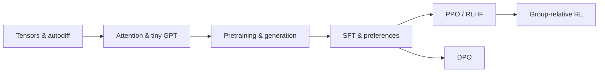

# 🧠 LLM from First Principles

**Understand every tensor, operation, and gradient—from a tiny GPT to policy optimization.**


A hands-on learning path with explicit derivations, small experiments, and a reusable PyTorch package. Build the mechanisms yourself, inspect their behavior, then compose them into a working language-model pipeline.

The notebook-learning workflow follows a deliberate rule:

> **Learning rule:** every learning implementation is typed and worked through manually.
>
> AI code completion is disabled. AI may be used as a tutor for explanations, derivations, questions, discussion, and code review, but not as an autocomplete or bulk code-generation workflow.
>
> **If I cannot explain a line of code, it does not belong here yet.**

This describes how the lessons are worked through, not a claim that repository maintenance, reusable-code extraction, or integration examples have never received AI assistance.

**📖 The story behind this project:** [Why I Built LLM from First Principles](https://neuromaancer.github.io/blog/why-i-built-llm-from-first-principles/) — why relying on coding agents made me want to write LLM and RL learning implementations myself again, question the choices behind working code, and distinguish lower training loss from better behavior. Also available in [中文](https://neuromaancer.github.io/zh/blog/why-i-built-llm-from-first-principles/) and [Français](https://neuromaancer.github.io/fr/blog/why-i-built-llm-from-first-principles/).

**[Explore the lessons](#-learning-path)** · **[Run the demo](#-run-a-small-complete-example)** · **[Use the source package](src/README.md)** · **[PyTorch reference](TORCH_FUNCTIONS.md)** · **[Learning philosophy](#-learning-philosophy)** · **[Data](data/README.md)**



## 🧭 Start where you need

| Your goal | Start here |
|---|---|
| Learn from the ground up | [Tensor basics](lessons/00_tensor_basics.ipynb), then follow the numbered notebooks. |
| Understand how a GPT fits together | [Transformer blocks and GPT](lessons/12_transformer_blocks_and_gpt.ipynb) → [pretraining](lessons/16_pretraining_a_tiny_gpt.ipynb). |
| Understand LLM post-training | [RL foundations](lessons/18_rl_foundations.ipynb) → [SFT](lessons/22_supervised_fine_tuning.ipynb) → [preferences](lessons/23_preference_data_and_reward_modeling.ipynb). |
| Reuse a mechanism in your own experiment | [Source guide and tensor contracts](src/README.md). |
| See the components run together first | [Checkpoint-free SFT/DPO example](examples/tiny_sft_dpo.py). |

## 🎯 What this repository is — and is not

This is primarily a **learning repository**, not a production LLM framework.

Educational implementations intentionally favor clarity over efficiency. Intermediate tensors may stay visible, algorithms may first be implemented explicitly, and related mechanisms may initially be written separately when that makes their differences easier to understand.

Once a mechanism has been implemented, derived, and verified, later lessons are free to use mature PyTorch primitives instead of repeatedly rebuilding the same idea.

**The point is not to reinvent PyTorch forever. The point is to understand what PyTorch is doing before relying on it.**

Basic Python and familiarity with vectors, derivatives, and probability are helpful; the early notebooks develop the PyTorch foundations. Toy results are learning observations, not benchmark claims.

## 🚀 Run a small, complete example

With [uv](https://docs.astral.sh/uv/) installed:

```bash
git clone https://github.com/neuromaancer/llm-from-first-principles.git
cd llm-from-first-principles
uv sync
uv run python examples/tiny_sft_dpo.py
```

The example connects **character tokenization → a tiny GPT → completion-only supervised fitting → a frozen reference → DPO → greedy generation**. It runs on CPU by default, uses three built-in synthetic examples, and needs **no dataset download, API key, or existing checkpoint**.

```bash
# A smaller smoke run; do not expect useful generations after four updates.
uv run python examples/tiny_sft_dpo.py --sft-steps 4 --dpo-steps 2

# Optional, with a working CUDA-enabled PyTorch installation.
uv run python examples/tiny_sft_dpo.py --device cuda
```

It prints before/after losses, preference-margin changes, generated responses, and whether the reference remained unchanged. The GPT starts from random weights: this demonstrates **SFT-style composition**, not fine-tuning a pretrained assistant. Fitting these examples is not evidence of generalization.

See [the source walkthrough](src/README.md#end-to-end-example) for the actual modules, tensor shapes, and limitations. Python and dependency requirements are declared in [`pyproject.toml`](pyproject.toml); the repository environment is recorded in `uv.lock`.

## 🧩 What lives where?

```text
lessons/             Derivations, handwritten experiments, and saved observations
src/llmfp/           Reusable model, data, generation, training, and RL primitives
src/README.md        API map, tensor contracts, and the integration walkthrough
examples/            Small runnable compositions of the source package
data/                Published teaching data, provenance, and corpus preparation
tests/               Focused numerical, gradient, and integration checks
TORCH_FUNCTIONS.md   Searchable PyTorch signatures, examples, and outputs
```

The source GPT uses rotary positions, RMSNorm, SwiGLU, and configurable query/KV heads. Linear attention and MoE are separate educational building blocks, not switches that silently replace the default GPT architecture. See [the module map](src/README.md#module-map).

## 📚 Learning path

Read in order for the complete derivation, or use the topic links below. There are 28 notebooks: lessons 00–26, with PPO split into 21A and 21B.

<details>
<summary><strong>01 · Language-model foundations — lessons 00–15</strong></summary>

| Notebook | What you will build or understand |
|---|---|
| [00 · Tensors](lessons/00_tensor_basics.ipynb) | Shapes, broadcasting, indexing, and reductions. |
| [01 · Autograd](lessons/01_autograd_from_scratch.ipynb) | Reverse-mode differentiation and gradient flow. |
| [02 · Tokenization](lessons/02_text_and_tokenization.ipynb) | Text representations, character tokens, and BPE concepts. |
| [03 · Batching](lessons/03_sequences_and_batching.ipynb) | Sequences, context windows, and next-token targets. |
| [04 · Embeddings](lessons/04_embeddings_and_linear_layers.ipynb) | Discrete IDs, learned representations, and linear layers. |
| [05 · Objectives](lessons/05_language_modeling_objectives.ipynb) | Softmax, likelihood, and cross-entropy. |
| [06 · Optimizers](lessons/06_optimizers_from_scratch.ipynb) | SGD, momentum, Adam, and AdamW. |
| [07 · Training loop](lessons/07_training_loop_from_scratch.ipynb) | Forward, backward, updates, and evaluation. |
| [08 · Causal attention](lessons/08_causal_self_attention.ipynb) | Queries, keys, values, and causal masking. |
| [09 · Multi-head attention](lessons/09_multi_head_attention.ipynb) | Head splitting and parallel attention patterns. |
| [10 · Normalization and FFNs](lessons/10_normalization_and_feed_forward.ipynb) | Normalization and gated feed-forward networks. |
| [11 · Positions](lessons/11_positional_information.ipynb) | Positional information and rotary embeddings. |
| [12 · GPT](lessons/12_transformer_blocks_and_gpt.ipynb) | Residual blocks and a decoder-only language model. |
| [13 · Generation](lessons/13_generation_and_kv_cache.ipynb) | Autoregressive decoding, sampling, and KV caching. |
| [14 · MQA and GQA](lessons/14_multi_query_and_grouped_query_attention.ipynb) | Query/KV head sharing and cache size. |
| [15 · Linear attention](lessons/15_linear_attention.ipynb) | Alternative attention and recurrent memory views. |

</details>

<details>
<summary><strong>02 · End-to-end pretraining — lesson 16</strong></summary>

[16 · Pretraining a tiny GPT](lessons/16_pretraining_a_tiny_gpt.ipynb) connects raw text, train/validation splits, token batches, GPT, AdamW, scheduling, checkpoints, perplexity, and generation.

</details>

<details>
<summary><strong>03 · Sparse computation — lesson 17</strong></summary>

[17 · Mixture of Experts](lessons/17_mixture_of_experts.ipynb) explores expert networks, top-k routing, dispatch/gather, utilization, balancing, capacity, and active versus total parameters.

</details>

<details>
<summary><strong>04 · Reinforcement-learning foundations — lessons 18–21B</strong></summary>

| Notebook | Focus |
|---|---|
| [18 · RL foundations](lessons/18_rl_foundations.ipynb) | Trajectories, returns, values, and Bellman equations. |
| [19 · Policy gradients](lessons/19_policy_gradients_and_reinforce.ipynb) | REINFORCE, baselines, and sampling estimators. |
| [20 · Actor–critic](lessons/20_actor_critic_td_and_gae.ipynb) | TD errors, bootstrapping, and GAE. |
| [21A · PPO](lessons/21a_ppo_from_scratch.ipynb) | Clipping, fixed rollouts, and policy/value updates. |
| [21B · PPO with GPT](lessons/21b_ppo_with_tiny_gpt.ipynb) | Token alignment, GPT actors/critics, and evaluation. |

</details>

<details open>
<summary><strong>05 · LLM post-training — lessons 22–26</strong></summary>

| Notebook | Focus |
|---|---|
| [22 · SFT](lessons/22_supervised_fine_tuning.ipynb) | Assistant-only targets, padding, and supervised fine-tuning. |
| [23 · Preference learning](lessons/23_preference_data_and_reward_modeling.ipynb) | Sequence log-probabilities, Bradley–Terry loss, and a reward head. |
| [24 · PPO-RLHF](lessons/24_rlhf_with_ppo_and_kl.ipynb) | Reference KL, generated rollouts, GAE, and policy updates. |
| [25 · DPO](lessons/25_direct_preference_optimization.ipynb) | Derive and optimize reference-relative preference margins. |
| [26 · Group-relative RL](lessons/26_modern_llm_rl_and_preference_optimization.ipynb) | GRPO/RLOO, loss weighting, KL estimators, and DAPO mechanisms. |

</details>

## 💡 Learning philosophy

### Build from simple operations upward

Understand `reshape`, `transpose`, broadcasting, matrix multiplication, reductions, and softmax before hiding them inside attention. When a mechanism is new, derive it and implement it explicitly.

### Predict tensor shapes and follow the gradients

Ask what every tensor represents, why it has that shape, and which operations preserve or stop its gradients. Predict the next shape before running the cell; use intermediate values and diagrams to check the explanation.

### Reuse a mechanism once it is understood

After implementing and understanding cross-entropy, later experiments can use `torch.nn.functional.cross_entropy`. The purpose is understanding, not ritual duplication or repeatedly rebuilding PyTorch.

### Refactor only after understanding the duplication

Keep new ideas visible in `lessons/`. Extract small, template-independent operations into `src/llmfp/` only when their tensor contracts are understood and there is a concrete reuse role. Avoid moving a whole teaching experiment into an unnecessary framework.

```text
understand → implement explicitly → check the mechanism → selectively extract → reuse
```

### Use a meaningful check, not a checklist

Prefer a small experiment that answers the question being studied: a gradient comparison, a tensor-alignment check, or a controlled policy update. More tests, algorithms, and abstractions are not automatically more understanding. Evaluate actual behavior separately from training loss, and preserve unsuccessful results as well as successful ones.

### Use AI as a teacher, not as an autocomplete engine

AI can explain an equation, challenge an intuition, discuss a design, review code, or suggest a useful experiment. During the learning exercises, code completion is disabled and the implementation is typed and reasoned through manually. The learner must be able to explain the code before relying on it.

## 🛠️ VS Code learning environment

The shared workspace configuration is in [`.vscode/settings.json`](.vscode/settings.json), with extension recommendations in [`.vscode/extensions.json`](.vscode/extensions.json).

The workspace sets `chat.disableAIFeatures` to `true` and `editor.inlineSuggest.enabled` to `false`. Copilot and Copilot Chat are listed as unwanted recommendations. This is a deliberate learning setup, not a requirement that readers adopt a particular editor or an assurance that every third-party extension is disabled.

The recommended extensions cover Python, Pylance, debugging, Ruff, Jupyter, and optional WSL support. Formatting on save, basic type checking, and an 88-column ruler support readable code without writing the learning implementation for you.

After `uv sync`, open the repository folder in VS Code, accept the relevant extension recommendations, and select the project `.venv` Python interpreter/kernel for the notebooks. Run the notebooks with `lessons/` as the working directory where their relative paths require it.

## 📓 Working with the notebooks

Most toy mathematics runs on CPU; checkpoint-backed GPT experiments may use CUDA.

**Not every notebook is standalone.** Lessons 22–25 reuse locally produced GPT checkpoints from earlier lessons. Follow the checkpoint paths in each notebook; model weights and generated artifacts are not committed. The small example above is the independent entry point when those artifacts are unavailable.

## 📦 Small datasets and provenance

The small synthetic datasets are published as [JSONL files under `data/toy/`](data/toy/), copied from the notebook definitions without changing the labels. They include the Lesson 22 SFT training/probe examples and the chosen/rejected preference pairs from Lessons 23 and 25. The integration demo uses the same three preference-training pairs.

[The data guide](data/README.md) documents schemas, source cells, serialization, and what each lesson's split means. A prompt held out from SFT may later be used in preference training: these are **lesson-specific teaching splits**, not a global untouched benchmark.

Tiny Shakespeare is approximately 1.1 MB. The ignored local training file was not available for this documentation change: the saved Lesson 16 output reports **1,115,390 characters**, while the pinned upstream snapshot contains **1,115,394**. They must not be described as byte-identical. A checksum-verified downloader provides the public upstream reference without overwriting an existing local corpus:

```bash
python data/prepare_tinyshakespeare.py
```

The data guide records the exact source, checksum, and discrepancy. `.gitignore` permits the single `data/raw/tinyshakespeare.txt` file to be versioned after checking the intended corpus, while other raw/processed data and checkpoints remain ignored. The existing notebooks and their inline teaching datasets are unchanged.

## ✅ Checks and contributions

```bash
uv run python -m unittest discover -s tests -v
```

Changes are easiest to review when they preserve public tensor contracts, include a focused check for changed behavior, and link back to the relevant lesson. Large checkpoints, generated datasets, and experiment outputs stay outside Git.
