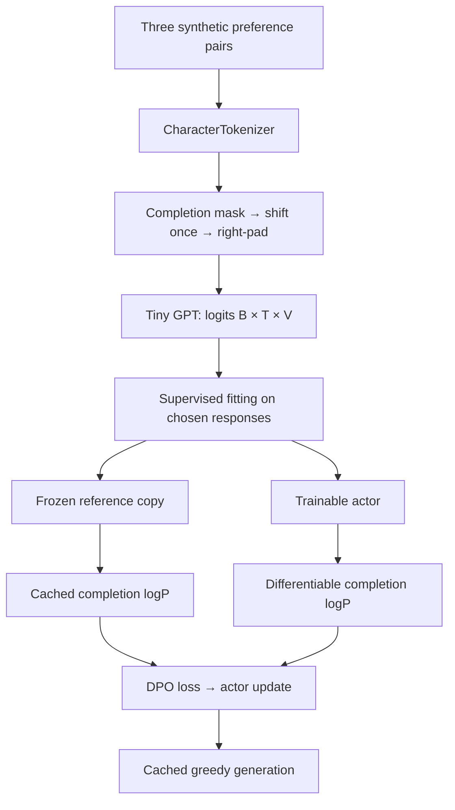

# Using `llmfp`

**Small, composable PyTorch primitives—not a hidden training framework.**

[← Project overview](../README.md) · [Run the example](../examples/tiny_sft_dpo.py) · [PyTorch reference](../TORCH_FUNCTIONS.md)

The notebooks explain each mechanism; this package is the reusable implementation. Start with the runnable composition below, then use the module map to find only the pieces your experiment needs.

## End-to-end example

From the repository root:

```bash
uv sync
uv run python examples/tiny_sft_dpo.py
```

[`examples/tiny_sft_dpo.py`](../examples/tiny_sft_dpo.py) is the executable source of this walkthrough. It creates a 10,720-parameter GPT, fits three preferred completions, freezes a separate reference model, performs DPO updates, and decodes both policies. It defaults to CPU, contains its own tiny dataset, downloads nothing, and reads/writes no checkpoints.



### 1. Encode and align once

`CharacterTokenizer` maps characters to IDs. A Boolean mask selects completion characters, including the example's final newline. `shift_supervised_tokens` aligns predictor inputs with next-token targets; `pad_supervised_batch` pads those pairs without shifting again.

| Quantity | Shape | Meaning |
|---|---|---|
| Full IDs / completion mask | `(L,)` | Prompt and response, before shifting. |
| Batch inputs / labels | `(B,T)` | Already aligned; ignored targets use `-100`. |
| GPT logits | `(B,T,V)` | One vocabulary distribution per predictor position. |
| Completion log-probabilities | `(B,)` | **Sum** of selected token log-probabilities. |
| Chosen / rejected scores | `(N_pairs,)` | Separate vectors for the preference objective. |

The example interleaves `[chosen, rejected]` for each prompt, so `[0::2]` and `[1::2]` select matching candidates.

### 2. Build the model

A minimal forward pass, independent of the demo's data preparation:

```python
import torch
from llmfp import GPT, GPTConfig

model = GPT(GPTConfig(
    vocab_size=32,
    embedding_dim=32,
    num_query_heads=4,
    num_kv_heads=2,
    num_layers=1,
    hidden_dim=64,
))
tokens = torch.randint(0, 32, (2, 8))
logits = model(tokens)  # (B=2, T=8, V=32)
```

`num_kv_heads == num_query_heads` gives MHA, `num_kv_heads == 1` gives MQA, and intermediate divisible configurations give GQA. The head dimension must be even for RoPE.

### 3. Compose supervised and preference losses

The full example supplies the inputs and optimizers. These are its essential operations:

```python
from llmfp.training import (
    per_example_sft_nll,
    completion_sequence_log_probs,
    dpo_loss,
)

# Each selected completion contributes one mean NLL.
sft_loss = per_example_sft_nll(model(inputs), labels).mean()

# Reference scores are computed without autograd; the actor remains trainable.
with torch.no_grad():
    ref_logps = completion_sequence_log_probs(reference(inputs), labels)
actor_logps = completion_sequence_log_probs(actor(inputs), labels)

loss = dpo_loss(
    actor_logps[0::2], actor_logps[1::2],
    ref_logps[0::2], ref_logps[1::2],
    beta=0.5,
)
```

`per_example_sft_nll(...).mean()` weights examples equally; a token-weighted batch loss is a different reduction. DPO takes complete-response **sums**, not mean token scores. The reference inputs detach inside `dpo_loss`, but freezing the reference model and using `no_grad` also avoids an unnecessary model graph.

### 4. Inspect outputs, not just loss

The demo prints supervised NLL, DPO loss, changes in chosen/rejected margins, greedy answers, and a full reference-state equality check. An illustrative CPU run with Python 3.13 / PyTorch 2.10 gave supervised NLL `3.519 → 0.021` and DPO loss `0.693 → 0.401`; exact floating-point results can vary.

All three examples are training data. The model starts from random weights, not a pretrained checkpoint. This is a wiring example—not an instruction-following evaluation, a DPO-versus-PPO comparison, or evidence of generalization.

## Module map

| Need | Start with | Learn the derivation |
|---|---|---|
| GPT / configuration | [`llmfp.models`](llmfp/models/gpt.py) | [12](../lessons/12_transformer_blocks_and_gpt.ipynb) |
| Attention, RoPE, FFN, linear attention, MoE | [`llmfp.nn`](llmfp/nn/) | [08](../lessons/08_causal_self_attention.ipynb)–[17](../lessons/17_mixture_of_experts.ipynb) |
| Tokenization, batching, supervised alignment | [`llmfp.data`](llmfp/data/) | [02](../lessons/02_text_and_tokenization.ipynb), [03](../lessons/03_sequences_and_batching.ipynb), [22](../lessons/22_supervised_fine_tuning.ipynb) |
| Greedy/sampled decoding and KV cache | [`llmfp.generation`](llmfp/generation/) | [13](../lessons/13_generation_and_kv_cache.ipynb) |
| SFT, sequence logP, Bradley–Terry, DPO | [`llmfp.training.losses`](llmfp/training/losses.py) | [22](../lessons/22_supervised_fine_tuning.ipynb)–[25](../lessons/25_direct_preference_optimization.ipynb) |
| Schedules, training steps, checkpoints | [`llmfp.training`](llmfp/training/) | [16](../lessons/16_pretraining_a_tiny_gpt.ipynb) |
| Returns, REINFORCE, GAE, PPO, KL, GRPO | [`llmfp.rl`](llmfp/rl/) | [18](../lessons/18_rl_foundations.ipynb)–[26](../lessons/26_modern_llm_rl_and_preference_optimization.ipynb) |
| Parameter and metric inspection | [`llmfp.utils`](llmfp/utils/) | [16](../lessons/16_pretraining_a_tiny_gpt.ipynb) |

## RL interfaces at a glance

`RolloutBatch` separates collection-time facts from current differentiable predictions. Use `rescore_actions_from_logits` for sampled-action logP and `align_state_values_for_actions` for the corresponding critic states. Both use complete prompt-response sequences and explicit action positions.

For group-relative credit assignment:

```python
from llmfp.rl import group_relative_advantages, grpo_clipped_policy_loss

rewards = torch.tensor([[1., 0., 0.]])  # (P=1 prompt, G=3 responses)
advantages = group_relative_advantages(rewards)
old_logp = torch.full((1, 3, 2), -0.7)
current_logp = old_logp.clone().requires_grad_(True)
mask = torch.ones((1, 3, 2), dtype=torch.bool)
loss = grpo_clipped_policy_loss(current_logp, old_logp, advantages, mask)
loss.backward()
```

This is the **policy-surrogate component**, not a complete GRPO trainer. It averages valid tokens within each response first; `ppo_policy_loss` instead averages all valid tokens globally. Optional asymmetric clipping does not turn it into full DAPO. Reference KL and actual rollout collection remain explicit caller responsibilities.

## Contracts worth keeping visible

- **Shift once.** Loss functions consume labels already aligned with logits. Prompt/padding targets are `-100`, never input IDs.
- **Padding is positional.** The causal right-padding helpers do not return a general attention mask and are not left-padding or sequence-packing utilities.
- **Sampling must match scoring.** Temperature or top-k/top-p filtering changes the behavior distribution; raw model logP is then not automatically the rollout logP.
- **Old policy is not reference policy.** PPO ratios use collection-time probabilities; KL regularization uses a separately fixed reference.
- **Generated text has a stopping convention.** Cached generation produces a fixed token budget; the demo extracts the first newline. No built-in chat template or EOS policy is assumed.
- **Small primitives are intentional.** Toy reward heads, critics, dataset rules, and experiment loops remain in notebooks unless they have an established reusable contract.

## Validation

From the repository root:

```bash
uv run python -m unittest discover -s tests -v
```

The small example has been exercised on CPU with Python 3.13 / PyTorch 2.10. The repository's declared dependency set and CUDA behavior were not reproduced in that check; `pyproject.toml` and `uv.lock` are unchanged. Full checkpoint-dependent notebook runs are separate experiments.
